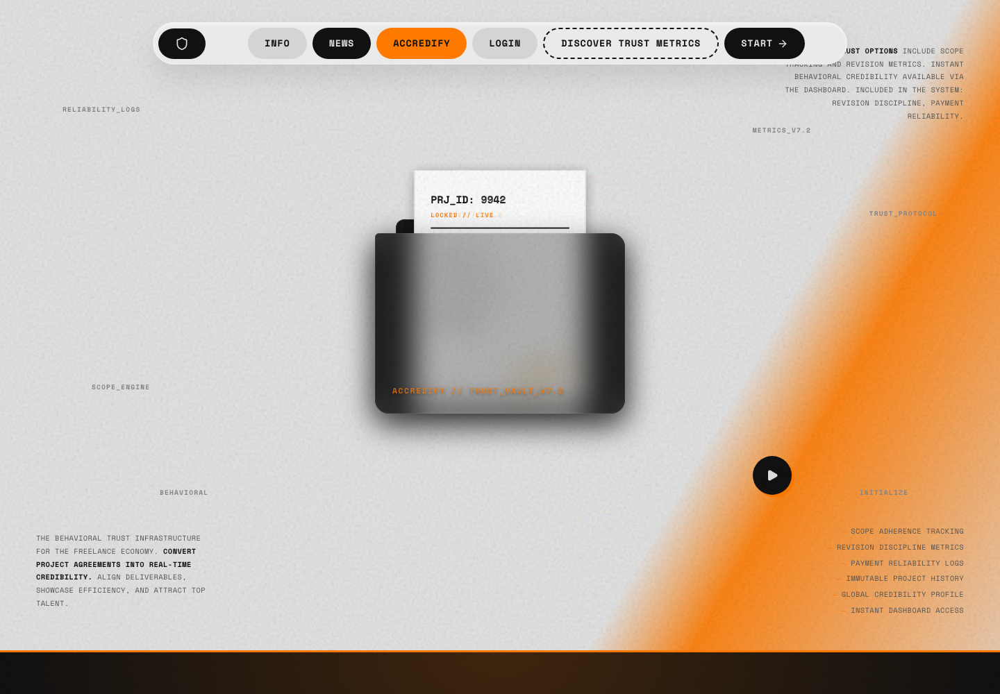
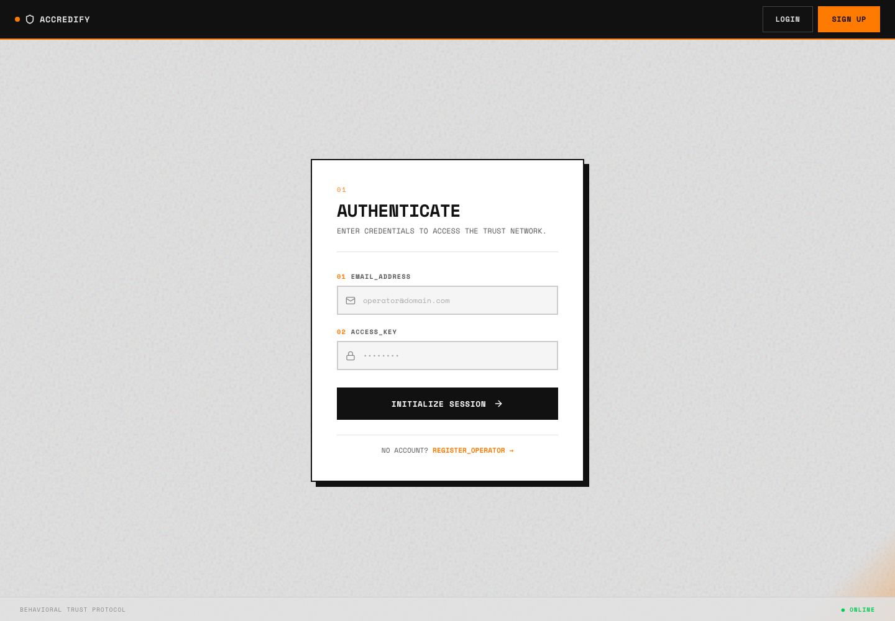
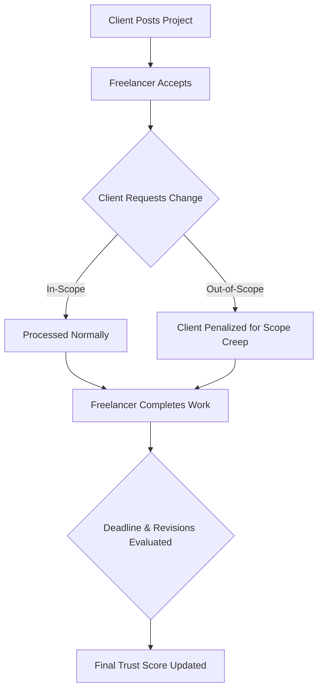

<div align="center">
  <h1>Accredify</h1>
  <p><strong>Behavioral trust and scope management platform for freelancers and clients</strong></p>
  
  <p>
    
    
    
    
  </p>
</div>

---

## 🧩 The Problem
Freelance engagements frequently suffer from power imbalances and ambiguous expectations.
- **Scope Creep:** Clients often request additional work outside agreed boundaries without proportional compensation.
- **Lack of Accountability:** Freelancers who miss deadlines or clients who demand endless revisions face no objective consequences that inform future collaborations.
- **Subjective Ratings:** Traditional star-rating systems are easily skewed, retaliatory, and fail to reflect actual behavioral reliability.

## 💡 The Solution
Accredify introduces an objective, behavioral-driven management platform.
- **Trust Score Engine:** Freelancers earn dynamically adjusted trust scores based on verifiable metrics like deadline adherence and revision limits. 
- **Scope Discipline Tracking:** Clients and freelancers are evaluated on how well they adhere to project bounds. Clients are penalized for out-of-scope demands, discouraging scope creep.
- **AI-Driven Interactions:** Users can navigate the platform and query their performance metrics using natural language commands, powered by an integrated AI engine.

---

## 📸 Screenshots

<table>
  <tr>
    <td width="50%" align="center">
      <strong>Landing Page</strong><br/><br/>
      <br/><br/>
      <em>The main interface and primary user entry point.</em>
    </td>
    <td width="50%" align="center">
      <strong>Login Page</strong><br/><br/>
      <br/><br/>
      <em>Secure authentication for clients and freelancers.</em>
    </td>
  </tr>
</table>

---

## ✨ Features

| Feature | Description |
| --- | --- |
| 🛡️ **Trust Score Engine** | Dynamically calculates scores based on deadlines, revisions left, and timely delivery. |
| 📐 **Scope Management** | Tracks "Scope Discipline" and "Scope Creep Index" based on change requests classification. |
| 💬 **AI Command System** | Natural language navigation and query answering (e.g., "What's my trust score?"). |
| 💼 **Project Tracking** | End-to-end management of projects including proposals, revisions, and status updates. |
| 📝 **Direct Messaging** | Built-in messaging system connecting clients and freelancers. |
| 🔐 **Role-Based Auth** | Secure JWT authentication distinguishing between Client and Freelancer accounts. |

---

## ⚙️ How It Works



---

## 🏗️ Architecture

Accredify uses a classic MERN stack architecture with a dedicated AI abstraction layer.

- **Frontend (Vite + React):** A fast, responsive single-page application handling routing, state management, and real-time interface updates.
- **Backend (Express API):** A RESTful Node.js service validating requests, enforcing business logic, and applying Trust Score calculations.
- **Data Persistence (MongoDB):** Mongoose models define schemas for Users, Projects, Messages, and ChangeRequests.
- **AI Command Layer:** A modular service capable of processing natural language intents using either OpenAI or Google Generative AI (Gemini) as the inference provider, with a fallback regex parser.

---

## 💻 Tech Stack

| Layer | Technology |
| --- | --- |
| **Frontend Framework** | React 19 (Vite) |
| **Styling & Animation** | Framer Motion, Lucide React, Vanilla CSS |
| **Backend API** | Node.js, Express 5 |
| **Database & ORM** | MongoDB, Mongoose 9 |
| **Authentication** | JWT, bcryptjs |
| **AI Providers** | OpenAI, Google Generative AI |

---

## 📂 Folder Structure

```text
accredify/
├── client/                 # React Frontend (Vite)
│   ├── src/
│   │   ├── components/     # Reusable UI elements (Navbar, Modals)
│   │   ├── context/        # React Context (Auth)
│   │   ├── pages/          # Full page views (Dashboard, Messages)
│   │   └── services/       # Frontend API communication
│   └── package.json
├── server/                 # Express Backend
│   ├── controllers/        # Route logic and request handling
│   ├── middleware/         # Auth and Validation middleware
│   ├── models/             # Mongoose schemas (User, Project)
│   ├── routes/             # Express API routes
│   ├── services/           # Core business logic (Trust Score, AI)
│   ├── seed.js             # Database seeding script
│   └── server.js           # API Entry point
├── docs/
│   └── screenshots/        # Project images and assets
├── package.json            # Root configuration
└── .env.example            # Environment variables template
```

---

## 🧠 Important Technical Subsystems

### Trust Score Engine (`trustScoreService.js`)
The core differentiator of Accredify. It computes a freelancer's trustworthiness dynamically:
- **Deadlines:** Submitting work before the deadline yields a bonus (`BONUS_BEFORE_DEADLINE`); missing it triggers an accumulating daily penalty.
- **Revisions:** Completing a project with revisions remaining grants a bonus.
- **Scope Creep Penalty:** Clients are penalized (`CLIENT_PENALTY_PER_OUT_OF_SCOPE`) for requesting out-of-scope changes, ensuring freelancers aren't punished for refusing unreasonable demands.

### AI Command Service (`aiCommandService.js`)
Users can control the application via natural language. The service:
1. Evaluates available environment variables to choose the active LLM (OpenAI vs Gemini).
2. Constructs a prompt incorporating the user's current route, project context, and trust stats.
3. Requests a strict JSON array of actions (`navigate`, `click`, `say`).
4. Falls back to a robust Regex parser if the LLM provider is unavailable or fails safety checks.

---

## 🚀 Installation and Local Development

### 1. Prerequisites
- Node.js (v18 or higher)
- MongoDB running locally or a MongoDB Atlas URI

### 2. Clone and Install
```bash
git clone https://github.com/your-username/accredify.git
cd accredify

# Install root dependencies
npm install

# Install client dependencies
cd client && npm install
cd ..
```

### 3. Environment Configuration
Copy the `.env.example` file to create your local `.env`:
```bash
cp .env.example .env
```

### 4. Database Seeding (Optional)
Populate the database with default test users (Client and Freelancer):
```bash
node server/seed.js
```

### 5. Start the Application
You will need two terminal windows to run both the frontend and backend.

**Terminal 1 (Backend):**
```bash
npm run start
```
*API will run on http://localhost:5000*

**Terminal 2 (Frontend):**
```bash
cd client
npm run dev
```
*Frontend will run on http://localhost:5173*

---

## 🔐 Environment Variables

| Variable | Required | Description |
| --- | --- | --- |
| `PORT` | No | API server port (default: 5000) |
| `MONGO_URI` | Yes | MongoDB connection string |
| `JWT_SECRET` | Yes | Secret key for signing authentication tokens |
| `JWT_EXPIRES_IN` | No | Token expiration duration (default: 7d) |
| `GEMINI_API_KEY` | No | Google Generative AI key for AI commands |
| `OPENAI_API_KEY` | No | OpenAI API key for AI commands (Alternative) |
| `DEBUG_AI` | No | Enables verbose logging for AI fallback events |

*Note: Never commit real API keys or JWT secrets to version control.*

---

## 🛡️ Performance, Security, and Reliability

- **Input Validation:** Enforced rigorously using `express-validator` to sanitize and verify all incoming API payloads before they reach controllers.
- **Secure Authentication:** Passwords are mathematically hashed via `bcryptjs` and session state is managed via secure HTTP-friendly JWTs.
- **Graceful AI Degradation:** If external LLM APIs fail, time out, or block a prompt due to safety thresholds, the system seamlessly falls back to a local Regex-based command parser, ensuring uninterrupted UX.
- **RESTful Error Handling:** Centralized custom middleware formats error responses consistently, preventing stack trace leaks in production environments.

---

## ⚖️ Why This Project Is Different

| Traditional Platforms | Accredify |
| --- | --- |
| Subjective 1-5 star ratings | Objective behavioral metrics (Trust Score) |
| Undefined revision rules | Strict limits evaluated algorithmically |
| Clients hold all power | Clients penalized for out-of-scope demands |
| Manual navigation | AI-assisted natural language navigation |

---

## 📝 License
This project is licensed under the ISC License.

---
*Generated by Antigravity*
